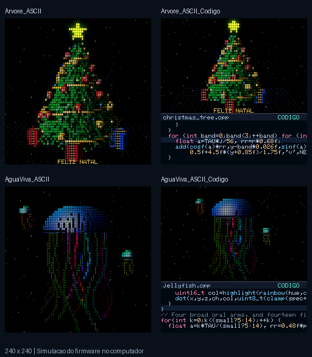
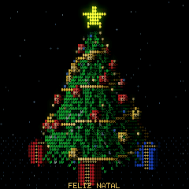
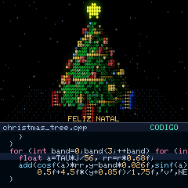
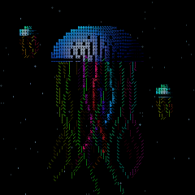
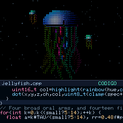

# Árvore de Natal e água-viva em ASCII

Quatro firmwares independentes para **Waveshare ESP32-S3-LCD-1.3**, com display integrado **ST7789 240 × 240**. Animações calculadas no ESP32, offline, com Arduino/C++ e Arduino_GFX. Implementação própria inspirada nas referências enviadas pelo usuário.

| Versão | Sketch para abrir no Arduino IDE | Pacote completo |
| --- | --- | --- |
| Árvore em tela cheia | [Arvore_ASCII.ino](Arvore_ASCII/Arvore_ASCII.ino) | [Baixar ZIP](downloads/Arvore_ASCII.zip?raw=true) |
| Árvore com código rolando | [Arvore_ASCII_Codigo.ino](Arvore_ASCII_Codigo/Arvore_ASCII_Codigo.ino) | [Baixar ZIP](downloads/Arvore_ASCII_Codigo.zip?raw=true) |
| Água-viva em tela cheia | [AguaViva_ASCII.ino](AguaViva_ASCII/AguaViva_ASCII.ino) | [Baixar ZIP](downloads/AguaViva_ASCII.zip?raw=true) |
| Água-viva com código rolando | [AguaViva_ASCII_Codigo.ino](AguaViva_ASCII_Codigo/AguaViva_ASCII_Codigo.ino) | [Baixar ZIP](downloads/AguaViva_ASCII_Codigo.zip?raw=true) |



As prévias são geradas pelo mesmo renderizador C++ do firmware, com tela/serial simuladas e a fonte da biblioteca Arduino_GFX. São imagens de **240 × 240 por versão**, não capturas de uma placa física. Os GIFs mostram parte do movimento; a cadência das prévias é independente do FPS real do ESP32.

[Comparação antes/depois da revisão de iluminação](previews/antes-depois.png).

## Efeitos

- **Árvore:** galhos em camadas, crescimento de baixo para cima, rotação completa a cada 20 segundos, fita dourada em espiral, bolas, luzinhas pulsantes, presentes, estrela, chão em perspectiva, partículas e mensagem “FELIZ NATAL”. A sequência de formação reinicia a cada 40 segundos.
- **Água-viva:** cúpula volumétrica pulsante, 14 tentáculos, quatro braços centrais, cores que mudam gradualmente, duas águas-vivas pequenas ao fundo e partículas.
- **Com código:** 156 pixels de altura para a cena, mais 84 pixels para um painel com trechos reais de C++ do efeito, rolagem vertical e cores de sintaxe. É um painel visual; os trechos exibidos não são um editor interativo. Linhas longas são cortadas nos 40 caracteres da tela.

A iluminação usa **normais da superfície e luz lateral fixa**, com áreas internas mais escuras, verdes em diferentes intensidades, reflexos nas bolas, faces dos presentes com tons diferentes e halo suave nas luzinhas e na estrela. Os próprios caracteres mudam conforme o brilho da superfície. A cúpula da água-viva recebe luz, reflexo e brilho de contorno; os tentáculos do fundo aparecem mais escuros. Isso é calculado durante o movimento, de modo que o sombreamento muda quando a árvore gira.

## Detalhe e resolução

A tela tem **240 × 240 pixels físicos**. O modo padrão usa uma grade de **80 × 60 caracteres** (80 × 39 na cena com código), com fonte 5 × 7 calculada em uma superfície virtual de 480 × 480 e reduzida com cobertura de pixels e compensação de brilho. Isso oferece o dobro das células da primeira versão 60 × 40, curvas mais suaves e maior densidade de detalhes. Só a cobertura dos caracteres é pré-calculada; não há um segundo framebuffer de 480 × 480.

Caracteres nessa densidade ficam muito pequenos. Para priorizar a nitidez de cada símbolo, altere no início do `.ino`:

```cpp
#define ASCII_HIGH_DETAIL 0 // grade 60x40 com fonte 3x5 nítida
```

O padrão é `1`, com o acabamento mais denso e suavizado. A resolução física é a mesma nos dois ajustes.

## Instalação

1. Baixe o ZIP da versão desejada em [`downloads/`](downloads/) e extraia a pasta inteira, **incluindo `src/`**. Também pode baixar este repositório inteiro em **Code → Download ZIP**.
2. Instale o pacote **esp32 by Espressif Systems** e a biblioteca **GFX Library for Arduino**, de **Moon On Our Nation**.
3. Abra o `.ino` dentro da pasta de mesmo nome. Cada versão inclui seus próprios headers; não precisa instalar uma biblioteca extra para as cenas.
4. Selecione **ESP32S3 Dev Module**, **Flash Size: 16 MB**, **PSRAM: OPI PSRAM**, **Partition Scheme: Huge APP** e **USB CDC On Boot: Enabled** para os comandos pelo monitor serial USB.
5. Escolha a porta e faça **Upload**. A gravação troca o firmware atual da placa pela animação escolhida. Para voltar ao simulador de líquido, grave novamente `LiquidCube_ESP32S3.ino`, que permanece disponível na pasta original.
6. Abra o Monitor Serial em **115200 baud**. Envie `p` para pausar/retomar ou `r` para reiniciar. Não há botão externo necessário para usar as animações.

Os sketches não acessam Wi-Fi, microSD nem sensores. O alvo de atualização é de até 25 FPS; o FPS obtido é medido pelo próprio firmware e informado a cada cinco segundos no serial.

## Hardware preservado

LCD: **DC=38, CS=39, SCK=40, MOSI=41, RST=42, BL=20**. Mesmos construtores ST7789 e SPI, offsets zerados, modo IPS e rotação de canvas `1` (90°) usados no simulador existente. Frequência SPI: 40 MHz. O QMI8658 não precisa ser inicializado para estes efeitos.

A árvore reserva **432.000 bytes** para até 18.000 pontos, preferencialmente na PSRAM, e usa **14.628 pontos**, incluindo normais compactas para iluminação e fatores de escurecimento interno. Há checagem de alocação e mensagem no display se faltar memória. O framebuffer RGB565 tem 115.200 bytes; a grade de profundidade ocupa 38.400 bytes e a grade de halo ocupa 9.600 bytes no modo de maior detalhe. A água-viva é calculada por quadro e dispensa a reserva de pontos da árvore.

## Prévias animadas

| Tela cheia | Com código |
| --- | --- |
|  |  |
|  |  |

## Fontes e manutenção

`engine/Scene.h` contém geometria, animação e projeção com buffer de profundidade por caractere. `engine/AsciiShow.h` contém tela, fonte suavizada, painel e controle de tempo. `engine/CodeLines.h` é gerado a partir de trechos do próprio `Scene.h`.

Depois de editar o engine, execute:

```sh
python3 AsciiShows/tools/generate.py
```

Isso atualiza as quatro pastas independentes. Os testes e a geração de prévias estão documentados em [VALIDACAO.md](VALIDACAO.md).

## Referências

- [Reel enviado pelo usuário](https://www.instagram.com/reel/DfoWsojSWA2/), junto dos prints de árvore e água-viva do perfil `dwcminh.ascii`.
- [Referência pública de árvore ASCII 3D em Python](https://gist.github.com/alenpaulvarghese/92aa3c5566a7c6bf92592c8c2d645298).
- [Waveshare ESP32-S3-LCD-1.3](https://www.waveshare.com/wiki/ESP32-S3-LCD-1.3).
- [Arduino_GFX](https://github.com/moononournation/Arduino_GFX).
